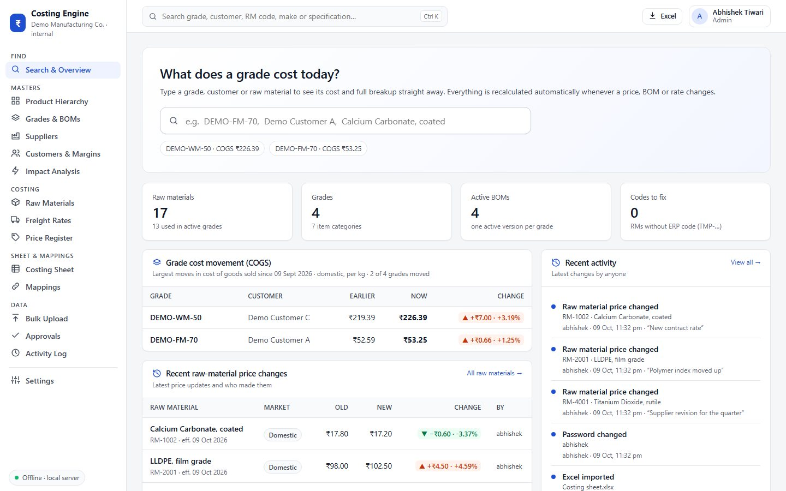
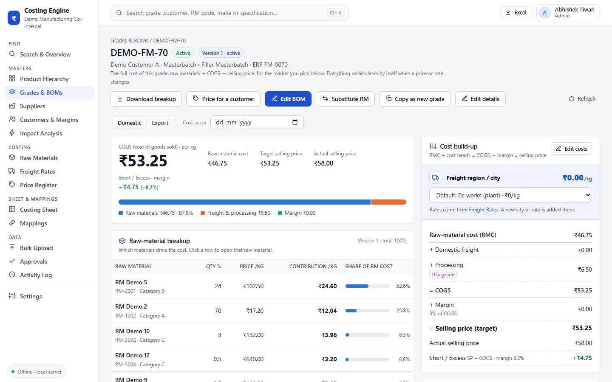
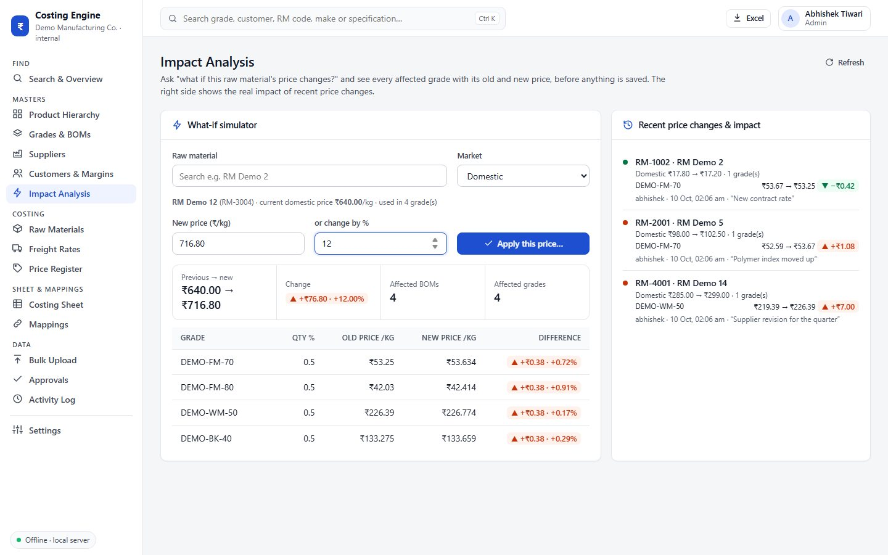
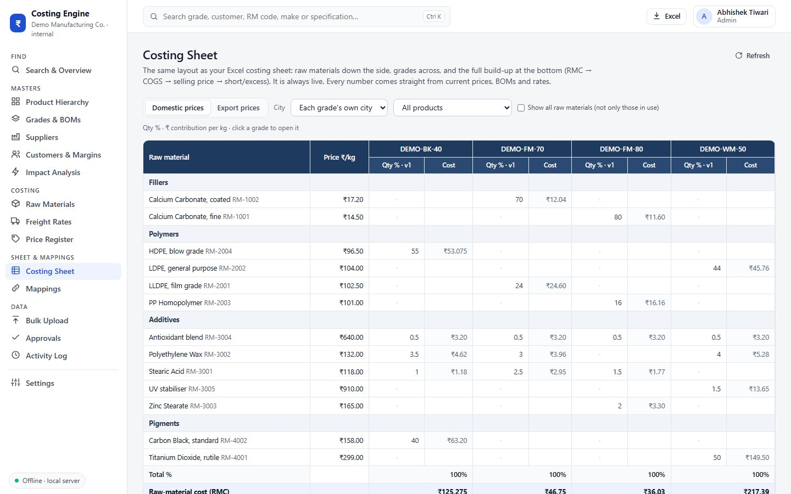
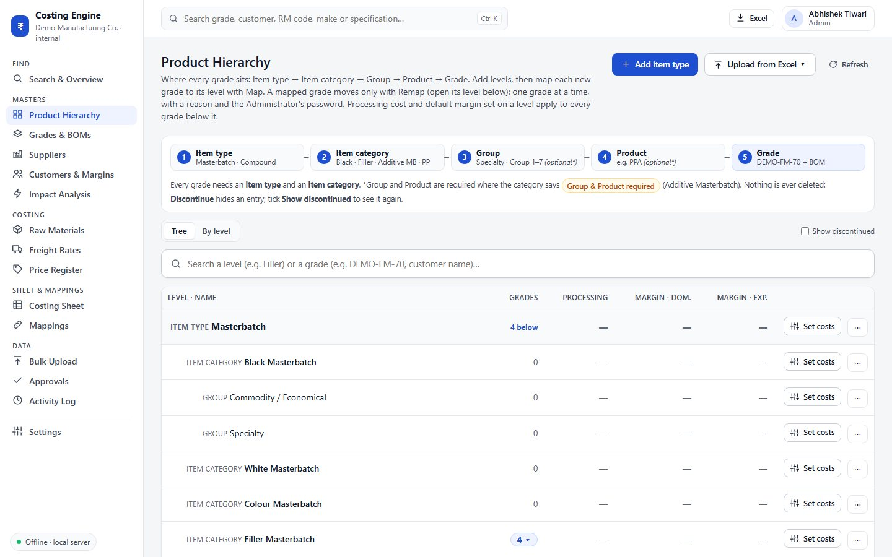
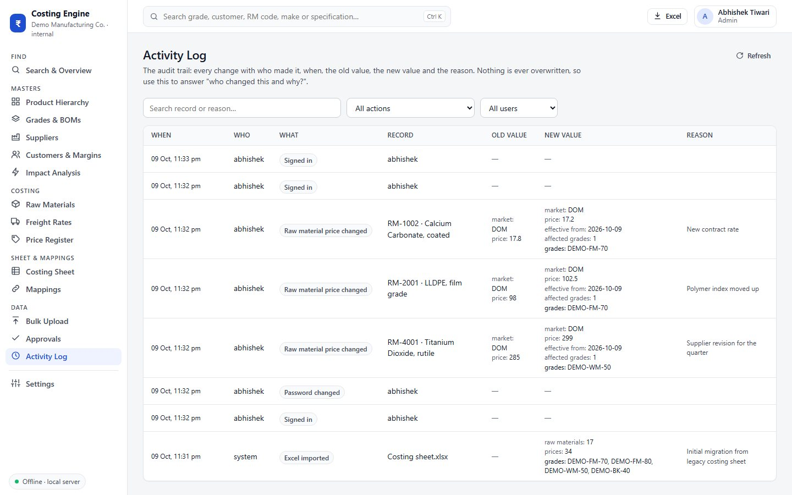
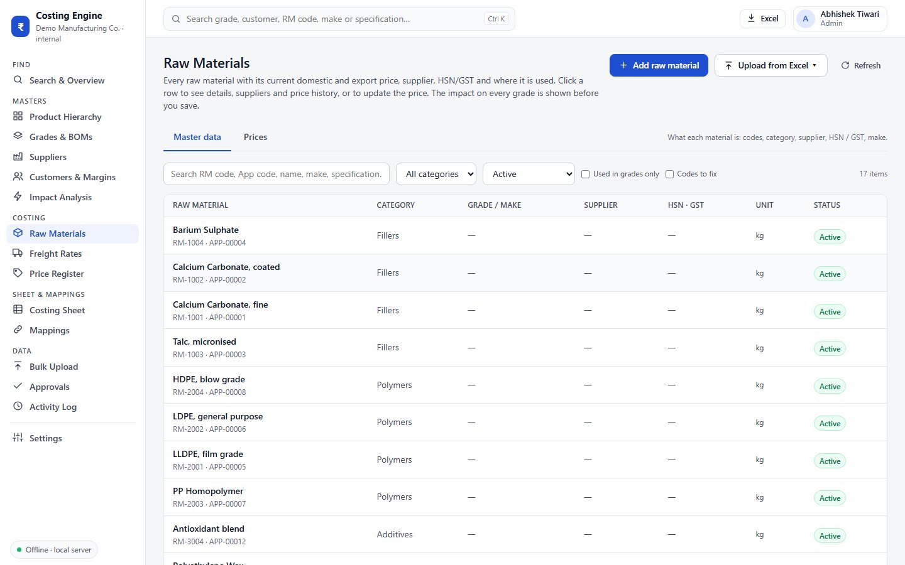
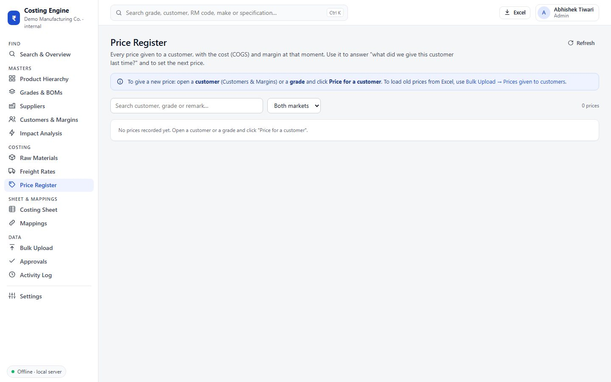
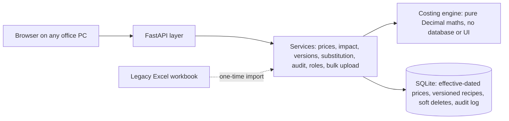

<h1 align="center">Manufacturing Costing Engine</h1>

<p align="center"><b>A web application that replaced a manufacturing company's costing spreadsheet.<br>Every product's cost is calculated from raw-material prices and recipes, recalculates itself when a price changes, and keeps a full record of who changed what and why.</b></p>

<p align="center">
  
  
  
  
  
  
</p>

<p align="center"></p>

<p align="center"><sub>All screenshots show the real application running on <b>made-up demo data</b>. The company's products, customers, suppliers and prices are not shown anywhere in this repository.</sub></p>

> **This repository explains the project. The source code is not public.**
> A few short excerpts are included so you can see how it is written.

---

## Contents

- [The problem](#-the-problem)
- [What I built](#-what-i-built)
- [How a cost is calculated](#-how-a-cost-is-calculated)
- [A tour of the application](#-a-tour-of-the-application)
- [How it is built](#-how-it-is-built)
- [How I made sure it is right](#-how-i-made-sure-it-is-right)
- [Code samples](#-code-samples)
- [Questions](#-questions)

More detail: **[Architecture](docs/ARCHITECTURE.md)** · **[Data model](docs/DATA-MODEL.md)** · **[Feature walkthrough](docs/FEATURES.md)** · **[Code samples](docs/CODE-SAMPLES.md)**

---

## 🧩 The problem

Product costing lived in one large Excel workbook: raw materials down the side, products across the top, and the cost build-up at the bottom.

| What went wrong | Why it mattered |
|---|---|
| Some costs were typed in by hand instead of calculated | A product could show a cost that no longer matched its recipe |
| A raw-material price change meant finding every product that used it | Easy to miss one; slow every time prices moved |
| "What if this price goes up 5%?" meant copying the sheet and editing it by hand | Pricing decisions waited on spreadsheet work |
| Nobody could say who changed a number, when, or why | No audit trail when a cost was questioned |
| Nothing stopped a recipe totalling 99.5%, a duplicated material, or text in a number cell | Errors went unnoticed until someone checked by hand |

A wrong cost means a wrong quote to a customer, so this was a business problem, not just a spreadsheet problem.

## ✅ What I built

An internal costing platform where **a product's cost is never typed in, only derived**.

| Before | After |
|---|---|
| Costs partly typed by hand | Every cost derived from prices and recipes |
| Hunting for affected products | Change one price → every affected product recalculates at once |
| What-if by copying sheets | Impact analysis: every affected product, old cost against new, **before** saving |
| No history | Every change logged: who, when, old value, new value, reason |
| No checks | Recipes must total 100%; uploads checked first and saved all-or-nothing |
| One shared file | Six user roles, each seeing only what they are allowed to do |

It runs **fully offline** on one office PC; everyone else opens it in a browser over the office network. Nothing needs installing on the other PCs and nothing is downloaded from the internet.

## 🧮 How a cost is calculated

```
Raw-material contribution  = quantity % × raw-material price        (per kg of finished product)
Raw-material cost (RMC)    = Σ contributions
+ Freight                    domestic: by city or region · export: per shipment, converted from USD
+ Processing                 set per product family; a product can override it
= Cost of goods sold (COGS)
+ Margin                     % or ₹/kg; per product, customer or category
= Target selling price
Actual selling price − COGS = Short / Excess  (profit or shortfall per kg)
```

Each cost head can be a **fixed ₹/kg**, a **% of raw-material cost**, or a **% of the running total**, so the build-up can be reshaped without changing code.

<p align="center"><br><sub>One product's cost: which materials drive it, and the full build-up from raw-material cost to selling price.</sub></p>

## 🖥️ A tour of the application

| Area | What it does |
|---|---|
| **Search & overview** | Type a product, customer or material and get its cost and full breakdown at once. Shows which products moved most and the latest price changes |
| **Product hierarchy** | Item type → category → group → product → grade. Processing cost and default margin set on a level flow down to everything below it |
| **Grades & recipes (BOMs)** | Edit a recipe with a live cost; substitute one material for another; copy a recipe into a new product; compare versions |
| **Raw materials** | Prices with full history, landed-price breakdown (basic + freight + duty + other), suppliers, tax codes |
| **Impact analysis** | "What if this price changes?": every affected product, old cost against new, before anything is saved |
| **Costing sheet** | The familiar spreadsheet layout, but live: materials down the side, products across, cost build-up at the bottom |
| **Freight rates** | Domestic rates by city or region; export ocean freight per shipment |
| **Customers & margins** | Margins per customer and product; price given to a customer recorded with a snapshot of the cost that day |
| **Bulk upload** | Excel templates for prices, materials, suppliers, recipes, freight and margins, checked in full before anything is saved |
| **Approvals** | Sensitive changes (renames, merges, remapping a product) go through an approval step |
| **Activity log** | Every change: who, when, what, old value, new value, reason |

<table>
<tr>
<td width="50%" align="center" valign="top"><br><sub><b>Impact analysis</b>: a 12% price rise and every product it touches, before saving</sub></td>
<td width="50%" align="center" valign="top"><br><sub><b>Costing sheet</b>: the layout people already knew, now always live</sub></td>
</tr>
<tr>
<td width="50%" align="center" valign="top"><br><sub><b>Product hierarchy</b>: costs and margins set once, inherited below</sub></td>
<td width="50%" align="center" valign="top"><br><sub><b>Activity log</b>: who changed what, when, and why</sub></td>
</tr>
<tr>
<td width="50%" align="center" valign="top"><br><sub><b>Raw materials</b>: codes, categories, suppliers, tax codes, status</sub></td>
<td width="50%" align="center" valign="top"><br><sub><b>Price register</b>: prices given to customers, with the cost on that day</sub></td>
</tr>
</table>

Full walkthrough: **[docs/FEATURES.md](docs/FEATURES.md)**

## 🏗️ How it is built



- **A pure calculation engine.** The engine takes plain inputs and returns a result. It never reads the database, the clock or the screen, so every number can be reproduced and unit-tested. Screens never calculate; they ask the services, which ask the engine.
- **Exact money maths.** Everything is Python `Decimal`, never `float`, so a cost calculated twice is always identical and matches a hand check.
- **Nothing is overwritten.** Prices are **effective-dated**, recipes are **versioned**, records are **soft-deleted**. Any past cost can be rebuilt exactly.
- **About 30 tables**: materials, prices, suppliers, recipes and their versions, the product hierarchy, cost heads and rates, freight, customers, margins, prices given, users and the audit log. See **[docs/DATA-MODEL.md](docs/DATA-MODEL.md)**.
- **Offline by design.** It carries its own Python runtime and libraries, so it needs no internet and no installation on other PCs.
- **Safe updates.** An update package backs up the data, tries the new version on a copy first, keeps the previous version and **rolls back by itself** if anything fails. Plus automatic and one-click backups.
- **Live refresh.** Pages update within seconds when someone else saves, without losing what you are typing.

Full detail: **[docs/ARCHITECTURE.md](docs/ARCHITECTURE.md)**

## 🧪 How I made sure it is right

- **62 automated tests** (14 on the engine, 48 on the services), run before every release.
- **Reconciled against the spreadsheet** it replaced, with every difference explained.
- **Acceptance test with a deliberately messy file**: codes with stray spaces and Excel's invisible non-breaking spaces, a recipe totalling 99.5%, a material listed twice, text in a number column, a category spelled slightly wrong. Every problem was caught with a plain-English message, the database stayed unchanged until the file was clean, and a simulated failure halfway through a save undid the whole upload.

## 🔍 Code samples

The core of the engine is the cost build-up. Each cost head is applied in order, on one of three bases:

```python
def _apply(item: CostItemInput, rm_cost: Decimal, running: Decimal, messages) -> Decimal:
    v = D(item.value)
    if item.basis == PER_KG:          # fixed ₹ per kg
        return v
    if item.basis == PCT_OF_RMC:      # % of raw-material cost
        return rm_cost * v / HUNDRED
    if item.basis == PCT_OF_TOTAL:    # % of the running total so far
        return running * v / HUNDRED
    messages.append(Message("error", "BAD_BASIS", f"{item.name}: unknown basis '{item.basis}'."))
    return ZERO
```

More excerpts, including recipe validation and the cost build-up loop: **[docs/CODE-SAMPLES.md](docs/CODE-SAMPLES.md)**

## 💬 Questions

Happy to talk through how it works, the design decisions, or how something similar could help your business. Email **abhishekvtiwari008@gmail.com** or message me on **[LinkedIn](https://www.linkedin.com/in/abhishekvtiwari/)**.

---

## Tools

`Python 3.12` · `FastAPI` · `SQLAlchemy 2` · `SQLite` · `Pydantic` · `openpyxl` · `pytest` · `HTML / CSS / JavaScript`

## Skills shown

Turning a business spreadsheet into a reliable, auditable system · data modelling (effective dating, versioning, soft deletes) · layered architecture with a pure, tested calculation engine · validation design with all-or-nothing imports · role-based access and audit trails · offline deployment with updates, backups and rollback · requirements gathering with costing, purchase, sales and management users

---

<p align="center"><sub>© Abhishek Tiwari. All rights reserved. This repository is a showcase; no licence is granted to copy or reuse the code excerpts. See <a href="LICENSE">LICENSE</a>.</sub></p>
