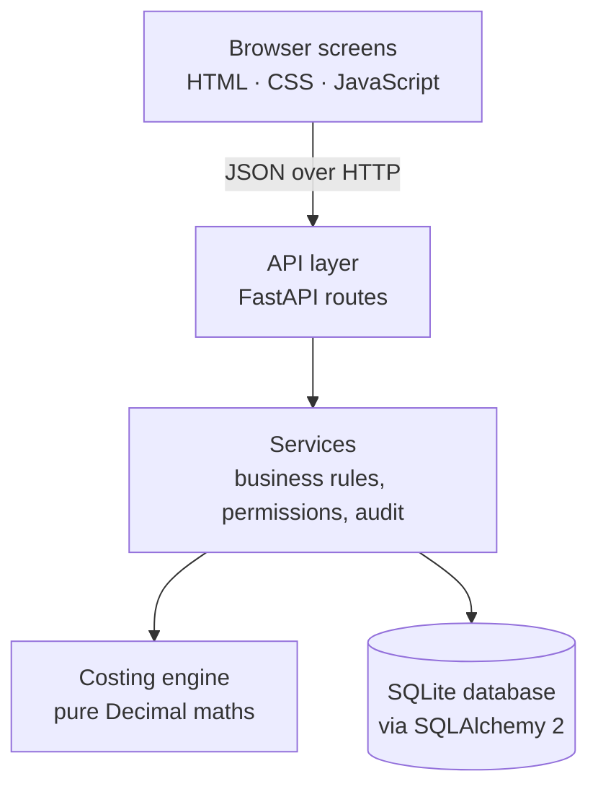

# Architecture

[← Back to the overview](../README.md)

The application is split into four layers. Each layer only talks to the one below it, so the calculation can be trusted and tested on its own.

## 1. Costing engine

The heart of the system, and the part I am most careful with.

- **Pure.** It receives everything it needs as plain inputs (recipe lines, prices, cost heads, exchange rates, selling price) and returns a result. It never reads the database, the clock or the screen.
- **Exact.** All arithmetic is Python `Decimal`. Floats are converted through their string form so `0.1` stays `0.1`.
- **Explains itself.** The result carries every line's contribution and share, every cost head's amount and where its value came from, plus a list of errors and warnings in plain English.
- **Validates.** Empty recipe, a material listed twice, a quantity of zero, a deactivated material, a recipe that doesn't total 100%, a missing price, a missing exchange rate: each produces a named message instead of a wrong number.
- **Compares.** A second function compares two results line by line, which powers impact analysis and version comparison.

Because it is pure, the 14 engine tests run in a fraction of a second and need no database.

## 2. Services

One module per business area: raw materials, prices, grades and recipes, the product hierarchy, freight rates, customers and margins, the price register, bulk upload, approvals, the dashboard, backups, users and the audit log.

Every service call receives a **context** (who is asking, with which role, on which database session). The first thing a service does is check permission, for example "can this user change a price?", so the rules live in one place, not in the screens.

Every change a service makes writes an **audit entry** in the same database transaction: action, record, old value, new value, reason, user, time. If the change fails, the audit entry is rolled back with it, so the log never lies.

## 3. API

A thin FastAPI layer that turns HTTP requests into service calls and returns JSON. Sign-in uses an HMAC-signed token in an HttpOnly cookie; passwords are stored as salted PBKDF2-SHA256 hashes, and every user must set their own password at first sign-in.

## 4. Screens

Plain HTML, CSS and JavaScript served by the same application, with **no internet libraries**, so the app works on an office network with no internet at all. Pages refresh on their own within seconds when someone else saves, without losing what you are typing.

## Data rules that keep history safe

| Rule | How |
|---|---|
| Prices are never overwritten | Each new price is a new row with an **effective-from date**. Today's cost uses the prices in force today |
| Recipes are versioned | Editing a recipe creates a new version; the old one is kept and can be compared or restored |
| Nothing is hard-deleted | Records are deactivated (soft delete) and can be shown again |
| Every change is logged | Append-only audit log with old and new values and the reason |
| Imports are all-or-nothing | A bulk file is checked in full first, then saved in one transaction |

So any past cost can be rebuilt exactly from the prices and recipe that applied on that date.

## Running offline

- One office PC runs the application; other PCs open it in a browser over the local network.
- The package carries its own Python runtime and libraries, so nothing is installed or downloaded on site.
- Start, stop, back up and update are one-click scripts for non-technical staff.

## Updates and backups

- **Update package:** backs up the database, applies the new version to a copy first, runs its checks, then switches over. The previous version is kept, and if anything fails the update **rolls back by itself**.
- **Backups:** automatic on a schedule, plus a one-click backup before any risky change.

[← Back to the overview](../README.md)
