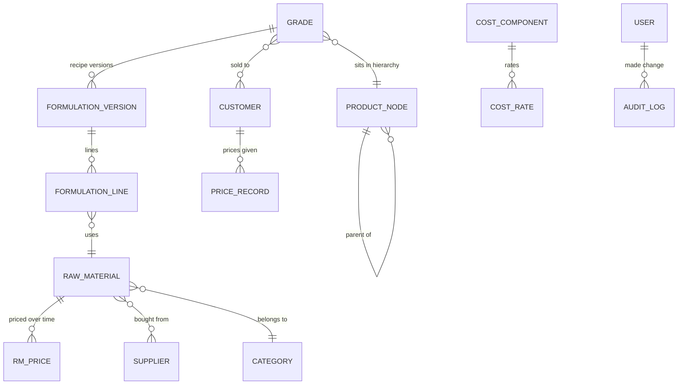

# Data model

[← Back to the overview](../README.md)

About 30 tables, grouped by what they describe. Field-level detail is part of the full source code.

## Materials and prices

| Table | Holds |
|---|---|
| Raw materials | Code, name, category, unit, tax code, status |
| Categories | Material groups (shown as Category A–D in the demo) |
| Suppliers, material–supplier links | Who supplies what, with make and specification |
| Raw-material prices | Price per market (domestic / export) with an **effective-from date** and an optional landed-cost breakdown |
| Markets, exchange rates | Domestic and export; USD rate used for export costing |

## Products and recipes

| Table | Holds |
|---|---|
| Product hierarchy | Item type → category → group → product, one self-referencing table |
| Product families | Shared processing settings |
| Grades | The finished products, linked to the hierarchy |
| Recipe versions | One row per version of a grade's recipe, with who made it and why |
| Recipe lines | Material and quantity % for each version |

## Costs, freight and margins

| Table | Holds |
|---|---|
| Cost components | The cost heads (freight, processing, overheads, margin…) and their basis |
| Cost rates, grade / level cost values | Values set per grade or per hierarchy level, inherited downwards |
| Regions, locations | Domestic freight by region or city |
| Ocean freight records | Export freight per shipment |
| Margin settings | Margin per product, customer or level |

## Customers and prices given

| Table | Holds |
|---|---|
| Customers, customer–grade links | Who buys what |
| Price records | A price given to a customer, with a **snapshot of the cost on that date** |
| Selling prices | Current actual selling price per grade and market |

## People and history

| Table | Holds |
|---|---|
| Users | Name, role, hashed password, must-change-password flag |
| Audit log | Every change: action, record, old value, new value, reason, user, time |
| Import records | Every bulk upload and its result |
| Approval requests | Renames, merges and remaps waiting for approval |

## Design choices

- **Money columns** use a custom column type that stores `Decimal` exactly, so values never pass through float.
- **Stamped tables** carry created / updated by and time on every row.
- **Effective dating** instead of updates for prices; **versioning** instead of edits for recipes; **status flags** instead of deletes.

[← Back to the overview](../README.md)
