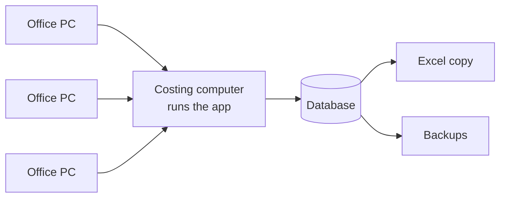

# How it works: the detailed guide

[← Back to the overview](../README.md)

This guide explains how the system works from the user's side: how a price is built, the rules it follows, and what happens step by step in every everyday task. Names and numbers in the examples are made up.

## Contents

1. [The big picture](#1-the-big-picture)
2. [How a selling price is built](#2-how-a-selling-price-is-built)
3. [The three promises](#3-the-three-promises)
4. [Which rate or margin wins](#4-which-rate-or-margin-wins)
5. [Everyday tasks, step by step](#5-everyday-tasks-step-by-step)
6. [Excel: the automatic copy and the review step](#6-excel-the-automatic-copy-and-the-review-step)
7. [Who can do what](#7-who-can-do-what)
8. [Built-in safety checks](#8-built-in-safety-checks)
9. [Running it: start, backups, restore, updates](#9-running-it-start-backups-restore-updates)

---

## 1. The big picture



- The application runs on **one office computer**. Everyone else opens it in Chrome or Edge using the office-network address.
- It **never goes on the internet**. It carries its own Python, so nothing is installed on any PC.
- Every page checks for changes every **15 seconds**. If someone else saves, your page refreshes by itself; if you are in the middle of typing, a bar offers **Refresh now** instead, so you never lose work.

## 2. How a selling price is built

Every number is calculated; none is typed in.

| Step | What is added | Where it is set |
|---|---|---|
| 1 | **Raw-material cost (RMC)** = Σ quantity % × material price | Material prices and the product's recipe |
| 2 | + Freight (₹/kg) | Region or location rate card |
| 3 | + Freight / transit loss (% of RMC) | Rate card |
| 4 | + Domestic cost (₹/kg) | Rate card, or per product |
| 5 | + Processing, packing, other (₹/kg) | Per product, or inherited from the product hierarchy |
| 6 | + Warehouse / storage (₹/kg) | Rate card |
| 7 | + Purchase overheads (% of RMC) | Company-wide rate |
| = | **Cost of goods sold (COGS)** | |
| 8 | + Margin: fixed ₹/kg **or** % of COGS | Product, customer or company default |
| = | **Target selling price** | |
| ↔ | **Short / Excess** = actual selling price − COGS | Actual price agreed per product |

**Worked example (demo numbers):** a product made of 70% *RM Demo 2* at ₹17.20 and 24% *RM Demo 5* at ₹102.50 plus small additives has a raw-material cost of ₹46.75/kg. Adding ₹6.50 processing gives a COGS of ₹53.25/kg. Sold at ₹58.00/kg, it earns ₹4.75/kg (8.2%).

## 3. The three promises

1. **Nothing is overwritten.** Every price, rate, margin and recipe change is kept with its date, who made it and why. You can see any product's cost **as on any past date**.
2. **Change once, updated everywhere.** Change a material price and every product that uses it is recalculated at once, on every screen, for every user.
3. **See the impact before you save.** Price changes, substitutions and recipe edits show the old and new cost of every affected product first.

## 4. Which rate or margin wins

**Freight and cost rates:** the most specific value wins.

```
product's own value  →  delivery location  →  freight region  →  all locations
```

**Margins:** a margin is **either** a fixed ₹/kg **or** a % of COGS, never both, and the most specific wins.

```
product  →  customer default  →  company default (per market)  →  0
```

Target selling price = COGS × (1 + %) or COGS + ₹/kg.

On every screen, each number shows **where it came from** (for example *region North* or *this product*), so nobody has to guess.

## 5. Everyday tasks, step by step

### Find what a product costs
1. Type the product, customer or material in the search box (or press **Ctrl + K** on any page).
2. Pick the result. The product page shows COGS, raw-material cost, target and actual price, profit or shortfall, which materials drive the cost, and the full build-up.
3. Switch **Domestic / Export**, pick a **freight region or location**, or choose **Cost as on** a past date.

### Update one material price
**Who:** Admin, Costing Manager, Purchase.
1. **Raw Materials** → open the material → **Update domestic price** (or export).
2. Type the new **landed price**, or fill the breakdown (basic + freight + duty + other) and let the app add it up.
3. The impact on every product appears **at once**.
4. Choose **Effective from** (today by default; a future date is allowed) and write a **reason**.
5. **Save.** Every product recalculates for everyone immediately.

A move of **20% or more** shows a warning, which catches typing slips such as 1390 for 13.90.

### Update many prices at once (bulk upload)
1. **Bulk Upload** → choose the template → **Download template**. It comes pre-filled with today's data.
2. In Excel, fill only what changes. Required columns are highlighted.
3. Upload the file. A **check screen** shows new rows, updates, unchanged rows and errors, each error in plain English.
4. Untick anything you don't want, write a reason, then **Apply**.

The whole file is checked first and saved in **one transaction**: either every ticked row is saved, or none is. Templates exist for prices, the material master, suppliers, recipes, freight and region rates, and customer margins.

### Change a recipe
**Who:** Admin, Costing Manager. Every save creates a **new version**; the old one stays.
1. Product → **Edit recipe**.
2. Change a quantity %, remove a line, or add a material.
3. Watch the **recipe total**. It must be exactly **100%**; **Balance** pushes the difference into one chosen material.
4. Check the new COGS against the current version, write the reason, set **Effective from**.
5. **Save & activate** (used for costing now) or **Save as draft** (activate later).

### Substitute a material
- **In one product:** product page → **Substitute RM** → choose what leaves and what replaces it (same %), review the impact, then save as a new version.
- **In every product at once:** open the material → **Replace in all products** → review → each affected product gets a new version.

### Create a new product
1. **New grade**, or **Copy as new grade** from an existing one (copies materials, %, cost heads and margin).
2. Fill the code, customer and place in the product hierarchy.
3. Adjust the recipe to 100%, write the reason, **Create**. Version 1 is active.

### Compare, activate and roll back versions
- **Compare** any two versions: price per kg of each, the difference, and every material's old and new % and cost impact.
- **Activate** an older or draft version with a reason; the current one is set aside, not deleted.
- **View** any old version to see what it cost then.

### Set margins
- **Customers & Margins** → open a customer → set location, freight region and a default margin (percentage or fixed) per market, with a reason. All that customer's products are repriced at once.
- For one special product: product page → **Edit costs** → margin section.

### Set freight and cost rates
- **Freight Rates** → click a value in the region or location rate card → new value, effective date, reason → **Save rate**.
- A message lists every product whose price changed, old → new.

### Ask "what if?"
1. **Impact Analysis** → pick a material and market.
2. Type a new price or a % change.
3. Read every affected product's old and new cost. **Nothing is saved.**
4. To make it real, **Apply this price…** opens the normal price form.

### Record a price given to a customer
Product page → **Price for a customer** → the price is saved with a **snapshot of the cost that day**, so the real margin of every quote can be checked later in the **Price Register**.

## 6. Excel: the automatic copy and the review step

- The application is the **master copy** of the data.
- After every change it rewrites a locked **Excel copy** of the whole database, so anyone can read the data in Excel and there is always a human-readable backup.
- If someone **edits and saves** that Excel, the app notices, puts the edited file aside and asks for a review.
- The review screen lists each difference (value in the app → value in the Excel, % change, products affected). Values that are out of date because the app changed after the Excel was written are ignored.
- **Nothing changes in the costing until someone accepts**, with a reason. Rejected files are kept for reference.

## 7. Who can do what

Everybody can **see** all costs. The role decides what a person can **change**; buttons you may not use are hidden.

| Action | Admin | Costing Manager | Purchase | Management | Sales | Viewer |
|---|:-:|:-:|:-:|:-:|:-:|:-:|
| Look up costs, products, materials, the costing sheet | ✓ | ✓ | ✓ | ✓ | ✓ | ✓ |
| Update material prices, add or edit materials and suppliers | ✓ | ✓ | ✓ | | | |
| Deactivate a material | ✓ | ✓ | | | | |
| Permanently delete a never-used material | ✓ | | | | | |
| Create or edit products and recipes | ✓ | ✓ | | | | |
| Activate or deactivate recipe versions | ✓ | ✓ | | ✓ | | |
| Cost heads, rates, regions, margins | ✓ | ✓ | | | | |
| Bulk upload: prices, material master, suppliers | ✓ | ✓ | ✓ | | | |
| Bulk upload: recipes, rates, margins | ✓ | ✓ | | | | |
| Review and accept Excel changes | ✓ | ✓ | | | | |
| Activity log (audit trail) | ✓ | ✓ | | ✓ | | |
| Download the Excel copy | ✓ | ✓ | ✓ | ✓ | | |
| Settings: cost heads, lists, exchange rate | ✓ | | | | | |
| Create users, change roles, reset passwords | ✓ | | | | | |

Every person gets their **own login**, so the activity log shows exactly who changed what. New users must set their own password at first sign-in (at least 8 characters with a capital letter and a number), and sessions end after 12 hours.

## 8. Built-in safety checks

| Check | What happens |
|---|---|
| Recipe must total 100% | Cannot be activated until it does |
| Same material twice in a recipe | Refused |
| Material with no price | Shown as *no price*; the cost is flagged, not guessed |
| Deactivated material in an active recipe | Refused (allowed only when recalculating history) |
| Price change of 20% or more | Warning before saving |
| Every change | Needs a reason; empty reasons are refused |
| Duplicate product code | Refused |
| Bulk file with any error | Errors listed in plain English; nothing saved until you apply the clean rows |
| A failure halfway through saving | The whole save is undone |
| Sensitive changes (rename, merge, remap) | Go through an approval step |

## 9. Running it: start, backups, restore, updates

**Start:** double-click the start file on the costing computer. A server window opens and shows two addresses: one for that computer and one for other office PCs. Keep the window open while people work.

**Back up:**
- **One click**, any time, even while people are working.
- **Automatic** backups, and an automatic backup **before every software update**.
- Copy the backups folder to a safe place weekly.

**Restore** (administrator): stop the app, set the current database file aside, copy the chosen backup in its place, start again.

**Update to a new version:** the update package backs up the data, tries the new version on a copy first, keeps the previous version, and **rolls back by itself** if anything fails.

[← Back to the overview](../README.md)
