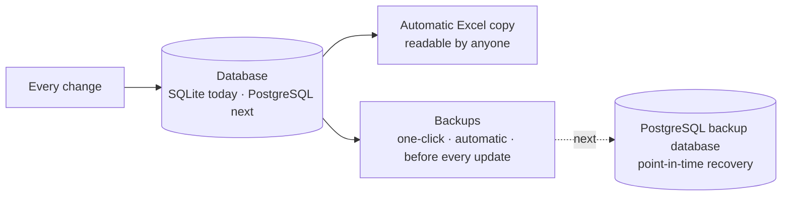

# Technology stack and upgrade path

[← Back to the overview](../README.md)

> **The production system at work runs on PostgreSQL. This showcase build uses SQLite so it runs offline on one PC with nothing to install.**

The first release was built to be **simple to run, safe with data and easy to upgrade**. It runs on one office computer with no installation and no internet. Every layer was chosen so it can be upgraded later without rewriting the business logic.

> **Status key:** ✅ built and in use · 🔜 planned upgrade (not built yet)

## The stack at a glance

| Layer | This showcase build ✅ | Upgrade path 🔜 | Why this order |
|---|---|---|---|
| **Screens (front end)** | HTML, CSS and plain JavaScript, served by the app itself. No internet libraries | A component **framework** (React + TypeScript), keeping the same screens and API | Plain HTML/JS works fully offline with nothing to install. A framework adds reusable components, richer charts and faster screen development once the design is settled |
| **Application (back end)** | Python 3.12 + **FastAPI** + Pydantic | Stays the same; add background jobs for very large recalculations and imports | FastAPI is fast, typed and documents its own API, so the front end can be swapped without touching it |
| **Calculation engine** | Pure Python, exact `Decimal` maths, no database or screen code | Unchanged | The costing rules are the most valuable part. Keeping them pure means no upgrade can change a number by accident |
| **Data management** | **SQLite**: one database file, so the showcase runs offline with nothing to install | **PostgreSQL**, as the production system at work already uses | SQLite needs zero setup and is ideal while the system proves itself. PostgreSQL handles many people saving at once, larger history tables and server-grade backups |
| **Database access** | SQLAlchemy 2 (database-independent) | Same code pointed at PostgreSQL, plus versioned schema migrations (Alembic) | Because all data access goes through SQLAlchemy, the move to PostgreSQL is a configuration change and a one-time data copy, not a rewrite |
| **Backups** | One-click backup, automatic backups, and an automatic backup before every update | PostgreSQL scheduled backups with point-in-time recovery, plus a backup database | Today a backup is a copy of one file. PostgreSQL adds restore-to-any-minute and a standby copy |
| **Excel** | Import of the original workbook, Excel templates for bulk upload, Excel download, and an **automatic Excel copy** of the whole database after every change | Kept as it is | People who prefer Excel can always read the data, and the Excel copy is a second, human-readable backup |
| **Hosting** | One office PC; other PCs use a browser over the office network | A dedicated office server (or private server) | More uptime and capacity, same browser experience |
| **Users and security** | Own user accounts, salted PBKDF2 password hashes, signed session cookie, six roles | Same model, more users and roles as departments join | Security rules live in the services, so they move with the app |
| **Quality** | 62 automated tests (pytest) run before every release | Tests run automatically on every change | Upgrades are checked against the same tests that protect today's numbers |

## Why this showcase build uses SQLite

- **Zero setup.** The whole database is one file. Nothing to install, configure or maintain on the office PC.
- **Easy to back up.** A backup is a copy of that file, taken in one click or automatically.
- **Enough for a demo.** One person or a small team on one PC is well within what SQLite handles.
- **No lock-in.** All data access goes through SQLAlchemy, so the same application code runs on PostgreSQL.

## What PostgreSQL adds (and why production uses it)

PostgreSQL is the right choice once any of these is true, which is why the production system uses it:

- many people saving changes at the same time, every day
- history tables (prices, versions, audit log) growing into hundreds of thousands of rows
- the need for a standby database, or restore-to-any-minute backups
- reports or other systems needing to read the data directly

## How the data is protected at every stage

1. **The database** is the single master copy.
2. **The Excel copy** is rewritten after every change, so the data can always be read in Excel. If someone edits that Excel, the app puts it aside for review; nothing changes until someone accepts.
3. **Backups** are taken in one click, automatically, and before every software update.
4. **Next:** PostgreSQL adds a dedicated backup database and point-in-time recovery.

## Delivery so far

| Phase | Deliverable | Status |
|---|---|---|
| 1 | Analysis of the costing workbook: sheets, formulas, relationships, gaps | ✅ |
| 2 | Data model and architecture | ✅ |
| 3 | Costing engine with automated tests | ✅ |
| 4 | Raw-material master with price history | ✅ |
| 5 | Products, recipes and versions | ✅ |
| 6 | Screens for every role | ✅ |
| 7 | Audit trail | ✅ |
| 8 | Excel import, export, bulk upload and Excel copy | ✅ |
| 9 | Domestic and export costing | ✅ |
| 10 | Impact analysis | ✅ |
| 11 | Testing across many products, reconciled to the workbook | ✅ |
| 12 | Showcase build: move from SQLite to PostgreSQL (as in production), plus React + TypeScript | 🔜 |

[← Back to the overview](../README.md)
